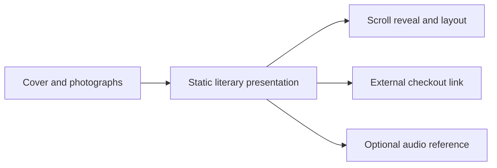

# 📖 L'Ultime Confrontation

## Architecture constatée



La page [index.html](index.html) contient une présentation du roman, des illustrations locales, une animation de révélation au défilement et un lien de paiement Stripe externe. Aucun moteur narratif à embranchements, lecteur du livre complet ou serveur de commandes n'est établi. La référence audio `musique_theme.mp3` ne correspond à aucun fichier présent à la racine inspectée. Le lien commercial, le prix et la distribution KDP ne sont pas vérifiés.

Qualification proposée : vérifier les droits des images, le texte, les ressources manquantes, la navigation clavier et les informations commerciales avant publication. Aucun achat, appel de paiement, test navigateur ou contrôle HTTP réalisé.

## English overview

Static promotional website for the novel L'Ultime Confrontation, with cover art, photographs, scroll animations and an external checkout link. The referenced local audio asset is missing from the inspected root. This is not the full book or an interactive narrative engine. No commercial, runtime or deployment validation was performed.

[Notice de droits](LICENSE.md) : droits existants préservés.

**Studio Niko Design** — Roman · Thriller ésotérique post-incendie Notre-Dame.

> Thriller ancré dans la reconstruction de Notre-Dame de Paris — 24 mars 2025. Auto-publication KDP.

## 📚 Le Roman
- **Genre:** Thriller ésotérique
- **Setting:** Paris — Notre-Dame post-incendie
- **Ancrage:** 24 mars 2025
- **Format:** 146 pages · 6×9 broché · EB Garamond 13pt
- **Influences:** Dantec / Beigbeder
- **Distribution:** Amazon KDP

## 🛠 Stack
`HTML` · `Cinzel` · `EB Garamond`

## 👤 Auteur
**Nicolas Julienne** — Auteur · [Studio Niko Design](https://github.com/Nikoju1977)
📧 nicolasjulienne.nj@gmail.com

---

## Présentation numérique

Ce dépôt contient une présentation HTML du roman et des ressources visuelles telles que la couverture. Pour la consulter localement, ouvrir `index.html` ou servir le dossier :

```bash
python3 -m http.server 8000
```

Puis visiter http://localhost:8000/. La consultation de ce dépôt n'est pas équivalente à la lecture ou à l'acquisition du livre complet.

## Droits d'auteur et diffusion

Les textes, couvertures et photographies peuvent être protégés par le droit d'auteur. **L'accès public au code et aux images n'accorde pas, à lui seul, de licence de reproduction ou d'exploitation commerciale.** Vérifier les droits et les conditions de vente auprès de l'auteur ou de la plateforme d'édition.

**Statut :** présentation et éléments de communication d'un projet littéraire ; liens de distribution et informations commerciales à confirmer avant réutilisation.

[Autres projets de Studio Niko Design](https://github.com/Nikoju1977).
